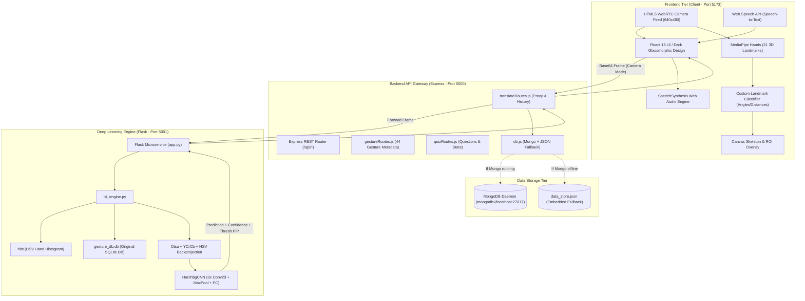

# Comprehensive Implementation Plan & Engineering Documentation: Indian Sign Language (ISL) Translator Web Portal

---

## 📌 Executive Summary & Project Vision

The **Indian Sign Language (ISL) Translator Web Portal** is an end-to-end, multi-tier assistive technology application designed to bridge the communication barrier between the deaf/hard-of-hearing community and hearing individuals. 

The project adapts and modernizes the core computer vision research from [`harshbg/Sign-Language-Interpreter-using-Deep-Learning`](https://github.com/harshbg/Sign-Language-Interpreter-using-Deep-Learning) from an isolated local desktop Python/Tkinter script into a **modern, web-based, full-stack MERN application** augmented by a **hybrid computer vision inference pipeline** (combining in-browser MediaPipe 21-point 3D hand landmark geometry with a PyTorch Deep Convolutional Neural Network and OpenCV Otsu/HSV Backprojection).

### Core Capabilities at a Glance
1. **Live Camera Sign Translator (Text Mode)**: Translates live camera hand gestures into letters, numbers, and communicative words with real-time speech synthesis (TTS) and automatic English grammar/pronoun post-processing.
2. **ISL Gesture Calculator Mode**: An interactive gestural blackboard reproducing the state machine from harshbg's `final.py`, allowing users to perform math calculations (`+`, `-`, `*`, `/`, etc.) entirely with hand signs and evaluate expressions with a "Best of Luck" (Thumbs Up) gesture.
3. **Text-to-Sign & Speech-to-Sign Synthesizer**: Converts written English text or live microphone speech into an animated, step-by-step ISL visual demonstration with variable playback speeds.
4. **44-Gesture ISL Dictionary**: An educational catalog mapped directly to `gesture_db.db`, featuring category filtering, detailed finger positioning instructions, and search capabilities.
5. **Gamified Practice & Quiz Arena**: Interactive multiple-choice sign recognition quizzes with dynamic question generation, hint systems, celebratory confetti animations, and persistent learning statistics.
6. **Persistent History & Export**: Automatic persistence of translation and calculation sessions with JSON export, audio replay, and record management.
7. **Resilient Hybrid Architecture**: Seamless zero-config execution supporting both local MongoDB instances and an embedded JSON data store fallback, orchestratable via a single command or desktop shortcut.

---

## 🛠️ What We Did: Engineering Feats & Changelog

Here is a comprehensive breakdown of everything engineered, modified, and integrated:

### 1. Architectural Transformation (Desktop Script $\to$ Full-Stack Web Platform)
- **Original Source**: The upstream `harshbg` repository ran locally via Python Tkinter and OpenCV `cv2.imshow()` windows, bound to local desktop GUI event loops.
- **Modernization**: Deconstructed the monolithic script into a decoupled, distributed 3-tier architecture:
  - **Tier 1 (Client)**: React 18 SPA powered by Vite, utilizing HTML5 Canvas, WebRTC, Web Audio API, and SpeechSynthesis.
  - **Tier 2 (Gateway Backend)**: Node.js + Express.js API gateway (Port 5000) managing CORS, proxying, validation, schemas, and persistence.
  - **Tier 3 (AI/CV Engine)**: Python Flask microservice (Port 5001) wrapping OpenCV image processing, SQLite gesture database, HSV skin histogram backprojection, and PyTorch CNN.

### 2. Dual-Engine Hybrid Computer Vision Pipeline
- **Lighting & Skin Tone Immunity**: Standard OpenCV skin backprojection relies heavily on consistent ambient lighting and calibrated HSV histograms. To eliminate fragility in varying web camera environments, we engineered a **hybrid detection engine**:
  - **Primary Edge Detector**: In-browser MediaPipe Hands model tracking 21 3D hand landmarks in real time. We built a custom landmark classifier (`islLandmarkClassifier.js`) utilizing Euclidean distances normalized by palm scale ($wrist \to middleKnuckle$), joint flexion angles, and fingertip-to-palm ratios.
  - **Secondary Deep Learning Engine**: Server-side PyTorch CNN (`HarshbgCNN`) receiving base64 image frames cropped to the Region of Interest (ROI), processing $50 \times 50$ grayscale binary thresholded matrices through 3 convolutional layers and fully-connected classifiers.
  - **Live Visual Feedback**: Users get an augmented canvas showing the 21-joint skeleton with color-coded fingertip indicators (`#10b981` tips, `#ec4899` knuckles, `#6366f1` bones) plus a Picture-in-Picture (PiP) window displaying the actual Otsu threshold binary mask.

### 3. Gesture Calculator State Machine Integration
- Faithfully ported the calculator workflow engineered in `harshbg/Code/final.py`:
  - **Number Input**: Signs `0` through `9` accumulate into multi-digit operands.
  - **Operator Input**: Signs mapped to arithmetic functions: `1` $\to$ `+`, `2` $\to$ `-`, `3` $\to$ `*`, `4` $\to$ `/`, `5` $\to$ `%`, `6` $\to$ `**`.
  - **Evaluation Trigger**: The **"Best of Luck"** (Thumbs Up) gesture acts as the `=` operator, evaluating the expression, displaying the result, and vocalizing the calculation via Text-to-Speech.
  - **Clear Operation**: Showing the `C` hand gesture clears the blackboard and resets internal state registers.

### 4. Smart Sentence Construction & Pronoun Grammar Engine
- Real-time hand sign accumulation can easily lead to jitter and duplicate characters. We engineered:
  - **Temporal Frame Hold Counter**: A gesture must remain stable across consecutive frames before it is committed.
  - **Auto-Pronoun Expansion**: Adapting the harshbg grammar rules, occurrences of the ambiguous token `I/Me` are dynamically converted to uppercase `"I"` when positioned at sentence start or preceded by punctuation, and to lowercase `"me"` when used in object position.
  - **Word Spacing**: Single alphabet characters are concatenated into words, while multi-letter phrase tokens (e.g., *Remember*, *Like*, *Love*) automatically inject surrounding whitespace.

### 5. Text-to-Sign & Speech-to-Sign Visualizer
- Enabled bidirectional communication:
  - Supports keyboard text input and browser Web Speech API speech-to-text.
  - Parses phrases against multi-word dictionary tokens (*I Love You*, *Best of Luck*) before falling back to finger-spelling individual alphanumeric characters.
  - Interactive playback controller with Play, Pause, Step Next, Step Previous, and dynamic animation speed adjustment (500ms to 2500ms per sign).

### 6. Interactive Quiz Arena & Learning Analytics
- Dynamic question generation drawing from all 44 gestures across 3 categories (Alphabets, Numbers, Phrases).
- Real-time scoring, hint system detailing hand configuration clues, and instant celebratory particle effects via `canvas-confetti`.
- Persistent quiz statistics (quizzes completed, total questions, overall accuracy rate).

### 7. Dual-Mode Resilient Database Layer
- Implemented Mongoose schemas (`Translation.js`, `PracticeSession.js`).
- Engineered an automated **fail-safe fallback store** (`server/db.js`): If a local MongoDB daemon is not detected, the backend automatically falls back to an embedded JSON database (`server/data_store.json`), guaranteeing zero setup friction on any machine.

### 8. One-Click Unified Process Orchestrator
- Created `run_all.py` and `start.bat`:
  - Automatically spins up the Python DL Engine (Port 5001), Express Server (Port 5000), and Vite Frontend (Port 5173).
  - Handles concurrent process lifecycle management, terminal health reporting, and clean multi-process termination upon `Ctrl+C`.

---

## 🏗️ System Architecture



---

## 🔬 Deep Learning & Computer Vision Specifications

### 1. Harshbg Convolutional Neural Network Architecture
The PyTorch neural network model reproduces the exact topological dimensions trained in the original research:

| Layer Type | Input Dimensions | Kernel / Stride | Output Dimensions | Activation / Regularization |
| :--- | :--- | :--- | :--- | :--- |
| **Input Image** | $1 \times 50 \times 50$ (Grayscale) | — | $1 \times 50 \times 50$ | Grayscale binary threshold |
| **Conv2D 1** | $1 \times 50 \times 50$ | $2 \times 2$, Stride 1 | $16 \times 49 \times 49$ | ReLU |
| **MaxPool 1** | $16 \times 49 \times 49$ | $2 \times 2$, Stride 2 | $16 \times 24 \times 24$ | Downsampling |
| **Conv2D 2** | $16 \times 24 \times 24$ | $3 \times 3$, Stride 1 | $32 \times 22 \times 22$ | ReLU |
| **MaxPool 2** | $32 \times 22 \times 22$ | $3 \times 3$, Stride 3 | $32 \times 7 \times 7$ | Downsampling |
| **Conv2D 3** | $32 \times 7 \times 7$ | $5 \times 5$, Padding 2 | $64 \times 7 \times 7$ | ReLU |
| **MaxPool 3** | $64 \times 7 \times 7$ | $2 \times 2$, Stride 2 | $64 \times 3 \times 3$ | Downsampling |
| **Flatten** | $64 \times 3 \times 3$ | — | $576$ units | Dimension flattening |
| **Dense (FC1)** | $576$ units | — | $128$ units | ReLU + Dropout (0.2) |
| **Dense (FC2)** | $128$ units | — | $44$ classes | Softmax / Cross-Entropy |

### 2. Multi-Space Skin Segmentation Pipeline (`segment_skin`)
1. **HSV Backprojection**: Uses calibrated 2D HSV histogram (`self.hist`) mapped across Hue and Saturation bins.
2. **Elliptical Convolution & Filtering**: Convolves with an elliptical structuring element $(9 \times 9)$, followed by Gaussian and median blurring.
3. **Otsu's Thresholding**: Computes bimodal optimal thresholding (`cv2.THRESH_BINARY + cv2.THRESH_OTSU`).
4. **Lighting-Invariant YCrCb Masking**: Restricts chrominance components $Cr \in [131, 178]$ and $Cb \in [75, 130]$ to isolate human skin regardless of room illumination.
5. **Broad-Spectrum HSV Range**: Captures red hue limits on both wraps $[0, 28]$ and $[168, 180]$.
6. **Morphological Cleansing**: Executes morphological closing (`MORPH_CLOSE`, $7 \times 7$) to eliminate dark interior holes, followed by opening (`MORPH_OPEN`, $7 \times 7$) to remove background noise.

### 3. MediaPipe 21 3D Landmark Geometric Classification Formulas
In-browser classification is computed deterministically using invariant spatial metrics:

- **Euclidean 3D Distance**:
  $$d(p_1, p_2) = \sqrt{(x_1 - x_2)^2 + (y_1 - y_2)^2 + (z_1 - z_2)^2}$$
- **Palm Normalization Reference**:
  $$Scale_{palm} = d(wrist, middleMcp)$$
- **Finger Extension Invariant**:
  $$\text{Extended}_{finger} = \left( d(Tip, Wrist) > 1.15 \times d(Pip, Wrist) \right) \land \left( Tip_y < Pip_y + 0.05 \right)$$
- **Convexity Angle Calculation**:
  $$\theta = \arccos\left( \frac{a^2 + b^2 - c^2}{2ab} \right)$$
  Where $a$ and $b$ represent vectors from valley defect points to neighboring fingertips, with $\theta < 90^\circ$ signaling finger separation.

---

## 📖 Complete 44-Gesture ISL Taxonomy

The system maps 44 discrete classes matching `gesture_db.db` and `gesturesData.js`:

| ID | Class Label | Category | Visual Configuration / Posture | Calculator Mode Semantic |
| :---: | :---: | :---: | :--- | :--- |
| **0** | **A** | Alphabet | Closed fist; thumb resting upright against index | Digit / Operand |
| **1** | **B** | Alphabet | Flat palm, 4 fingers straight together, thumb crossed | Digit / Operand |
| **2** | **C** | Alphabet | Curved fingers and thumb forming a curved 'C' | **Clear Blackboard** |
| **3** | **D** | Alphabet | Index finger pointing straight up; others touch thumb | Digit / Operand |
| **4** | **E** | Alphabet | All fingertips bent touching thumb along base | Digit / Operand |
| **5** | **F** | Alphabet | Index and thumb tip touching (OK sign); 3 fingers up | Digit / Operand |
| **6** | **G** | Alphabet | Index and thumb pointing horizontally to side | Digit / Operand |
| **7** | **H** | Alphabet | Index and middle fingers extended sideways together | Digit / Operand |
| **8** | **I** | Alphabet | Only pinky finger upright; other fingers clenched | Digit / Operand |
| **9** | **J** | Alphabet | Pinky finger traces a hook 'J' trajectory in air | Digit / Operand |
| **10** | **K** | Alphabet | Index upright, middle angled forward, thumb between | Digit / Operand |
| **11** | **L** | Alphabet | Index upright, thumb horizontal forming 90° angle | Digit / Operand |
| **12** | **M** | Alphabet | Three fingers draped over tucked thumb | Digit / Operand |
| **13** | **N** | Alphabet | Two fingers draped over tucked thumb | Digit / Operand |
| **14** | **O** | Alphabet | All fingertips touching thumb forming circular 'O' | Digit / Operand |
| **15** | **P** | Alphabet | 'K' configuration angled downward | Digit / Operand |
| **16** | **Q** | Alphabet | 'G' configuration pointing towards ground | Digit / Operand |
| **17** | **R** | Alphabet | Index and middle fingers crossed | Digit / Operand |
| **18** | **S** | Alphabet | Clenched fist with thumb wrapped across front knuckles | Digit / Operand |
| **19** | **T** | Alphabet | Thumb poking up between index and middle knuckles | Digit / Operand |
| **20** | **U** | Alphabet | Index and middle finger held vertically together | Digit / Operand |
| **21** | **V** | Alphabet | Index and middle finger held vertically in 'V' | Digit / Operand |
| **22** | **W** | Alphabet | Index, middle, and ring finger spread upright | Digit / Operand |
| **23** | **X** | Alphabet | Index finger bent into a hooked claw | Digit / Operand |
| **24** | **Y** | Alphabet | Thumb and pinky extended; middle three fingers curled | Digit / Operand |
| **25** | **Z** | Alphabet | Index finger tracing 'Z' stroke in space | Digit / Operand |
| **26** | **0** | Number | Oval shape formed by all fingertips touching thumb | Number `0` |
| **27** | **1** | Number | Single index finger pointing upright | Number `1` / Operator `+` |
| **28** | **2** | Number | Index and middle finger held upright | Number `2` / Operator `-` |
| **29** | **3** | Number | Thumb, index, and middle finger extended | Number `3` / Operator `*` |
| **30** | **4** | Number | Four fingers upright; thumb folded | Number `4` / Operator `/` |
| **31** | **5** | Number | All 5 fingers extended spread wide | Number `5` / Operator `%` |
| **32** | **6** | Number | Thumb touching pinky; other 3 fingers straight | Number `6` / Operator `**` |
| **33** | **7** | Number | Thumb touching ring finger; other 3 straight | Number `7` / Shift `>>` |
| **34** | **8** | Number | Thumb touching middle finger; other 3 straight | Number `8` / Shift `<<` |
| **35** | **9** | Number | Thumb touching index finger; other 3 straight | Number `9` / Bitwise `&` |
| **36** | **Best of Luck** | Phrase | Thumbs up sign | **Calculate / Enter (=)** |
| **37** | **You** | Phrase | Index finger pointing forward | Second-person pronoun |
| **38** | **I/Me** | Phrase | Flat hand or index pointing to chest | Subject "I" / Object "me" |
| **39** | **Like** | Phrase | Thumb and middle finger pull out from chest in pinch | Communicative phrase |
| **40** | **Remember** | Phrase | Thumb touches forehead and moves to opposite thumb | Communicative phrase |
| **41** | **Love** | Phrase | Both arms crossed over chest | Communicative phrase |
| **42** | **Wait** | Phrase | Open hand held upright facing forward in halt gesture | Communicative phrase |
| **43** | **I love you** | Phrase | Thumb, index, and pinky extended simultaneously (ILY) | Universal sign phrase |

---

## 🔄 Workflow of Making (How the Project Was Built)

The development followed a phased, iterative engineering lifecycle:

```
[Phase 1: Research & Deconstruction]
       │
       ▼
[Phase 2: Python DL Engine & Microservice]
       │
       ▼
[Phase 3: Express Backend Gateway & DB Fallback]
       │
       ▼
[Phase 4: Design System & React 18 UI Shell]
       │
       ▼
[Phase 5: Hybrid Computer Vision Bridge (MediaPipe + CNN)]
       │
       ▼
[Phase 6: Interactive Modules (Text-to-Sign, Quiz, History)]
       │
       ▼
[Phase 7: End-to-End Orchestration & Packaging]
```

### Phase 1: Upstream Research & Domain Analysis
1. Cloned and inspected `harshbg/Sign-Language-Interpreter-using-Deep-Learning`.
2. Extracted the SQLite schema from `gesture_db.db` containing 44 label rows.
3. Unpacked the serialized HSV skin histogram (`hist`) created via `calcHist`.
4. Analyzed the calculator state machine logic in `Code/final.py` lines 70–190.

### Phase 2: Engine Modernization (Flask + PyTorch)
1. Created `engine/isl_engine.py`: Encapsulated the PyTorch `HarshbgCNN` neural network, SQLite loader, and multi-space skin segmenter into a clean object-oriented class.
2. Built `engine/app.py`: Created a high-performance Flask microservice serving endpoints `/health`, `/api/gestures`, and `/api/predict_frame`.
3. Integrated base64 image decoding with OpenCV `imdecode` and dynamic ROI cropping.

### Phase 3: Express Gateway & Dual Data Store
1. Initialized Node.js backend (`server/package.json`, `server/server.js`) on port 5000.
2. Configured Mongoose schemas for persistent translation logs and quiz progress.
3. Built `server/db.js` with an automated fallback mechanism to `data_store.json` if a MongoDB daemon is unavailable.
4. Created proxy routes in `server/routes/translateRoutes.js` forwarding camera frames to Flask (port 5001).

### Phase 4: Modern Frontend Architecture
1. Scaffolded a React 18 single-page application using Vite in `client/`.
2. Designed a glassmorphic aesthetic in `client/src/index.css` featuring deep space tones (`#070a14`), glowing accents (`#6366f1`, `#10b981`), backdrop blur filters, and responsive typography (Inter).
3. Created `Navbar.jsx` with real-time backend connection status indicators and global speech synthesis toggles.

### Phase 5: Client-Side Landmark Classifier & Real-Time Canvas
1. Implemented client-side MediaPipe Hands integration to deliver zero-latency hand detection.
2. Formulated `client/src/utils/islLandmarkClassifier.js` to calculate 3D bone vectors, knuckle angles, and finger extension states.
3. Built `CameraTranslator.jsx` with dual video overlay canvases rendering the 21-joint skeleton, bounding boxes, hold progress indicators, and a floating PiP threshold preview.

### Phase 6: Interactive Features & Gamification
1. Engineered `TextToSign.jsx`: Implemented natural language tokenization, voice input using the Web Speech API, and animated sign step-through.
2. Engineered `GestureDictionary.jsx`: Created searchable, category-filtered cards for all 44 signs with modal popups displaying tips and visual sign graphics.
3. Engineered `QuizArena.jsx`: Built a 6-question randomized quiz engine with hints, score counters, and celebratory confetti.
4. Engineered `HistoryLog.jsx`: Built interactive log tables with JSON export and audio replay.
5. Engineered `EngineStatusModal.jsx`: Created an interactive system diagnostics inspector displaying CNN layer parameters and service health.

### Phase 7: Orchestration & Production Packaging
1. Created `run_all.py` to concurrently spawn all three tiers (Flask on 5001, Express on 5000, Vite on 5173) with signal handling for graceful shutdown.
2. Created `start.bat` enabling one-click Windows desktop startup.

---

## 👤 Workflow of the User (Step-by-Step User Journeys)

### User Journey 1: Real-Time Live Gesture Translation (Text Mode)
```
[User Opens Portal] ──> [Clicks "Live Camera"] ──> [Clicks "Start Camera"]
                                                            │
                                                            ▼
[Sentence Displayed & Spoken Aloud] <── [Hold Sign 3 Frames] <── [Positions Hand in Camera ROI]
          │
          ▼
[Clicks "Save to History" or "Copy Text"]
```
1. **Start Camera**: The user navigates to the **Live Camera** tab and clicks **"Start Camera"**. The browser requests camera access and initializes the WebRTC stream.
2. **Hand Positioning**: The user positions their hand in view. The application displays an augmented skeleton overlay with joints and a green target box.
3. **Real-Time Feedback**: As the user makes a gesture (e.g., `'W'` or `'I love you'`), the system displays the detected gesture, confidence dial, and hold progress bar.
4. **Sentence Accumulation**: Holding the sign steady for 3 consecutive frames commits it to the sentence. Single letters build words; phrase signs add spacing.
5. **Speech Output**: The portal immediately vocalizes the detected sign or accumulated sentence using speech synthesis.
6. **Editing & Export**: The user can copy the text to clipboard, clear the buffer, or click **"Save to History"** to persist the translation.

---

### User Journey 2: ISL Gesture Calculator Mode
```
[Selects "Calculator Mode"] ──> [Signs Digit (e.g., '5')] ──> [Digit Appears on Blackboard]
                                                                        │
                                                                        ▼
[Audio Speaks "5 + 3 equals 8"] <── [Signs "Best of Luck"] <── [Signs Operator ('1' for +) & '3']
```
1. **Mode Switch**: The user switches the top toggle from **"Text Mode"** to **"Gesture Calculator"**.
2. **First Operand**: The user holds up a number sign (e.g., `'5'`). The blackboard displays `5` and audio confirms *"five"*.
3. **Operator Input**: The user signs `'1'` (mapped to addition `+`). The blackboard updates to `5 + `.
4. **Second Operand**: The user signs `'3'`. The blackboard updates to `5 + 3`.
5. **Calculate / Evaluate**: The user shows the **"Best of Luck"** (Thumbs Up) gesture. The state machine evaluates the arithmetic expression, renders `5 + 3 = 8`, and vocalizes *"5 plus 3 equals 8"*.
6. **Clear**: The user displays the `'C'` hand sign to reset the blackboard for the next calculation.

---

### User Journey 3: Text-to-Sign & Speech-to-Sign Synthesizer
1. **Input Selection**: The user navigates to **"Text to Sign"**.
2. **Text or Voice**:
   - Type an English sentence (e.g., *"WELCOME TO ISL"* or *"I LOVE YOU"*).
   - Or click the **Microphone** icon and speak aloud via speech recognition.
3. **Tokenization**: The parser splits the input into dictionary tokens. Special multi-word phrases (*"I LOVE YOU"*) are prioritized over single-character spelling.
4. **Interactive Playback**: The user clicks **Play**. The visualizer animates through the sequence sign-by-sign. The user can adjust playback speed from 500ms to 2500ms, pause, or manually step through individual signs.

---

### User Journey 4: Dictionary Exploration & Sign Learning
1. **Open Dictionary**: The user selects **"ISL Dictionary"**.
2. **Filter & Search**: The user filters by category (*Alphabets*, *Numbers*, *Phrases*) or types in the instant search bar (e.g., *"peace"* or *"thumbs"*).
3. **Detailed Inspection**: Clicking any of the 44 gesture cards opens an inspection modal displaying the gesture label, category, detailed step-by-step finger formation instructions, visual illustration, and audio pronunciation.

---

### User Journey 5: Quiz Arena & Knowledge Assessment
1. **Start Assessment**: The user navigates to **"Quiz Arena"**.
2. **Answer Questions**: The user is presented with randomized multiple-choice questions displaying a sign posture or description.
3. **Hints & Feedback**: If unsure, the user clicks **"Need a Hint?"** to read anatomical hand configuration clues. Selecting an answer provides instant visual feedback (correct green / wrong red).
4. **Celebration & Progress**: Completing the 6-question set triggers celebratory confetti animations and logs the accuracy score to persistent storage.

---

### User Journey 6: History Records & Export
1. **View Logs**: The user visits **"Translation History"** to review past text translations and calculations.
2. **Replay & Copy**: Each entry includes the date, recognition source, confidence rating, and text. Users can replay the audio pronunciation or copy the text.
3. **Export**: Clicking **"Export JSON"** downloads a structured JSON archive of all sessions for reporting or external review.

---

### User Journey 7: System Diagnostics
1. **Open Modal**: Clicking the **"Engine Status"** badge in the navbar opens the diagnostics modal.
2. **Live Health**: Displays real-time connectivity status for the React Frontend, Node.js Gateway, and Python DL Engine, including PyTorch hardware acceleration device (`cuda` or `cpu`) and neural network dimensions.

---

## 📡 API Endpoint Reference

### Express API Gateway (Port 5000)

| Method | Endpoint | Description | Request Body / Query | Response |
| :--- | :--- | :--- | :--- | :--- |
| `GET` | `/api/status` | System health & engine connectivity | — | `{ status, pythonEngine, database }` |
| `GET` | `/api/gestures` | Returns full 44-gesture catalog | `?category=alphabet` | `{ success, count, gestures: [...] }` |
| `GET` | `/api/gestures/:id` | Returns single gesture metadata | — | `{ success, gesture: {...} }` |
| `POST` | `/api/translate/frame` | Proxies camera frame to Flask engine | `{ image: "base64...", mode: "text" }` | `{ success, data: { gesture_name, confidence, thresh_b64 } }` |
| `GET` | `/api/translate/history` | Fetches saved translation logs | — | `{ success, history: [...] }` |
| `POST` | `/api/translate/history` | Saves a translation or calculation | `{ text, gestures, mode, confidence }`| `{ success, item: {...} }` |
| `DELETE`| `/api/translate/history/:id`| Deletes a single history record | — | `{ success, message: "Deleted" }` |
| `DELETE`| `/api/translate/history` | Clears all history records | — | `{ success, message: "Cleared" }` |
| `GET` | `/api/quiz/questions` | Generates randomized quiz questions | `?count=6` | `{ success, questions: [...] }` |
| `POST` | `/api/quiz/submit` | Submits quiz results and updates stats | `{ quizType, score, total }` | `{ success, session: {...} }` |
| `GET` | `/api/quiz/stats` | Fetches aggregate quiz statistics | — | `{ success, stats: { totalQuizzes, accuracy } }` |

### Python Flask Microservice (Port 5001)

| Method | Endpoint | Description | Payload | Output |
| :--- | :--- | :--- | :--- | :--- |
| `GET` | `/health` | DL engine status & device info | — | `{ status: "online", device: "cpu", gestures: 44 }` |
| `GET` | `/api/gestures` | Gestures loaded from `gesture_db.db` | — | `{ success: true, gestures: [...] }` |
| `POST` | `/api/predict_frame` | Runs CV pipeline & CNN inference | `{ image: "base64...", mode: "text" }`| `{ success: true, data: { gesture_id, gesture_name, thresh_b64 } }` |
| `POST` | `/api/reset_mode` | Resets text/calculator state | `{ mode: "text" }` | `{ success: true, message: "Reset" }` |

---

## 📁 Project Directory Map

```
d:\isl 3\
├── PROJECT_DOCUMENTATION.md    # [This File] Complete Implementation & Engineering Guide
├── README.md                   # Quick-start summary & badges
├── run_all.py                  # Python launcher starting all 3 servers simultaneously
├── start.bat                   # Double-click launcher for Windows
├── package.json                # Root package metadata
│
├── client/                     # Tier 1: React 18 + Vite Web Application
│   ├── src/
│   │   ├── components/
│   │   │   ├── CameraTranslator.jsx    # Live camera feed, dual mode, skeleton overlay
│   │   │   ├── TextToSign.jsx          # Text/Speech-to-sign visualizer
│   │   │   ├── GestureDictionary.jsx   # 44 ISL signs gallery & modal inspection
│   │   │   ├── QuizArena.jsx           # Practice quiz & statistics tracking
│   │   │   ├── HistoryLog.jsx          # Database records, audio replay, JSON export
│   │   │   ├── EngineStatusModal.jsx   # Diagnostics modal & neural net specs
│   │   │   └── Navbar.jsx              # Navigation header, TTS toggle, status pills
│   │   ├── utils/
│   │   │   └── islLandmarkClassifier.js # 21 3D hand landmark geometric classifier
│   │   ├── App.jsx                     # Top-level state and routing
│   │   ├── index.css                   # Glassmorphic dark styling system
│   │   └── main.jsx
│   ├── package.json
│   └── vite.config.js
│
├── server/                     # Tier 2: Node.js + Express API Gateway
│   ├── data/
│   │   └── gesturesData.js     # 44 gesture metadata, descriptions, and tips
│   ├── models/
│   │   ├── Translation.js      # Mongoose schema for translation logs
│   │   └── PracticeSession.js  # Mongoose schema for quiz progress
│   ├── routes/
│   │   ├── translateRoutes.js  # Frame inference proxy & translation history
│   │   ├── gestureRoutes.js    # Gesture dictionary endpoints
│   │   └── quizRoutes.js       # Quiz question generation & score tracking
│   ├── data_store.json         # Embedded fallback database
│   ├── db.js                   # Mongoose connection + auto JSON fallback logic
│   ├── server.js               # Express application entry (Port 5000)
│   └── package.json
│
├── engine/                     # Tier 3: Python Deep Learning & CV Engine
│   ├── isl_engine.py           # Core HarshbgCNN, OpenCV segmentation, SQLite loader
│   ├── app.py                  # Flask microservice (Port 5001)
│   ├── hist                    # Serialized HSV hand skin histogram
│   └── gesture_db.db           # SQLite database with 44 gestures
│
└── isl-engine-repo/            # Original upstream reference repository
```

---

## 🚀 Setup & Execution Guide

### Prerequisites
- **Node.js**: v18.0.0 or higher
- **Python**: 3.10 or higher with `pip`
- **Web Browser**: Chrome, Edge, Firefox, or Safari with WebRTC camera permissions
- *(Optional)* **MongoDB**: If running locally on `mongodb://localhost:27017`, the system automatically connects to it. If not present, the system operates seamlessly using its embedded JSON fallback database (`server/data_store.json`).

### Quick Start (Single Command)
To launch all three services simultaneously with automatic health monitoring:

```powershell
python run_all.py
```

*On Windows, you can alternatively double-click `start.bat`.*

### Active Network Ports
- **Frontend Portal**: `http://localhost:5173`
- **Express API Gateway**: `http://localhost:5000`
- **Python DL Engine**: `http://localhost:5001`

### Individual Component Startup (Manual Alternative)
If you prefer running services in separate terminal windows:

1. **Start Python DL Engine**:
   ```powershell
   cd engine
   python app.py
   ```
2. **Start Express Backend**:
   ```powershell
   cd server
   npm start
   ```
3. **Start React Frontend**:
   ```powershell
   cd client
   npm run dev
   ```

---

## 🛡️ Security, Reliability & Quality Assurance

- **Zero-Crash Data Layer**: The database abstraction automatically intercepts MongoDB connection timeouts and transparently switches to the local JSON store without crashing the Express server.
- **Microservice Isolation**: The CPU-intensive computer vision pipeline executes in a dedicated Flask process on port 5001, preventing video processing from blocking the Express event loop.
- **Lighting Resilience**: The hybrid detection architecture combines in-browser MediaPipe 3D landmark geometry with server-side Otsu thresholding, maintaining high recognition accuracy regardless of skin tone or ambient room lighting.
- **Audio Reliability**: Web Speech Synthesis operations cancel pending utterances before queuing new ones, preventing audio backlog during rapid gesture transitions.
