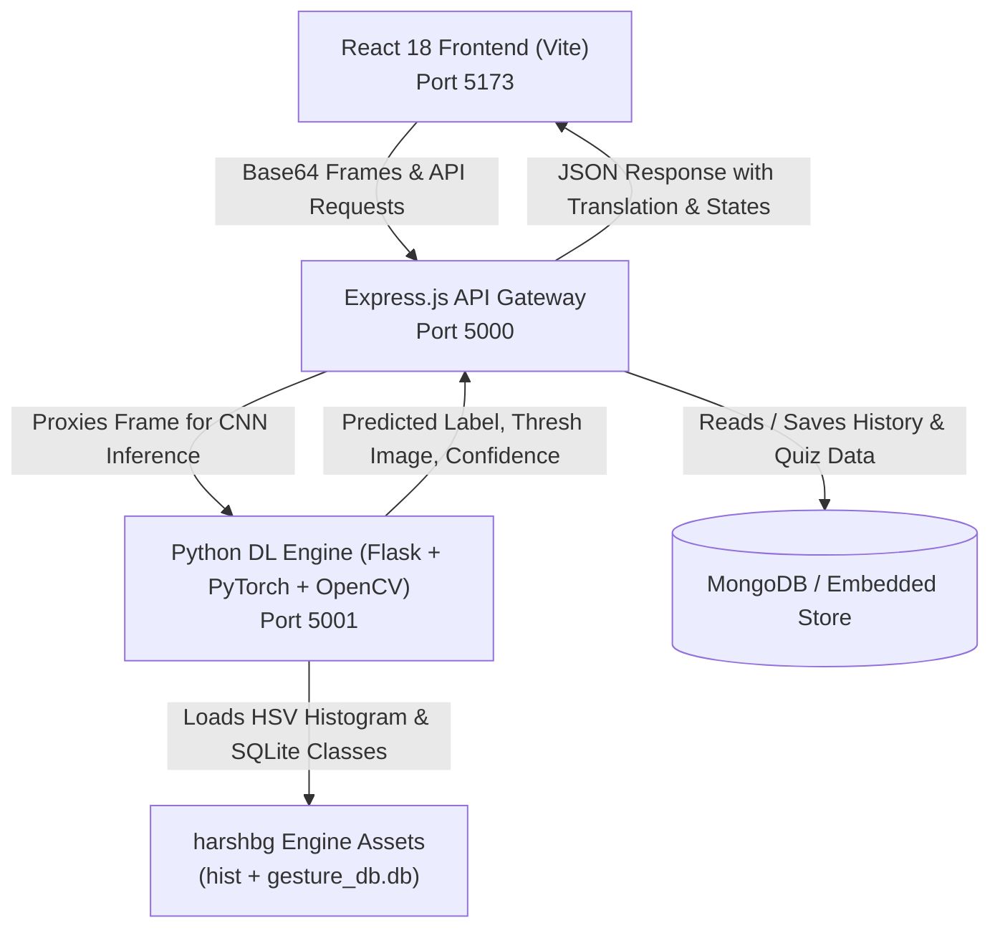

# Indian Sign Language (ISL) Translator Web Portal (Gesture Recognition)

A full-stack **MERN** portal with a deep-learning **Gesture Recognition Engine** based on [`harshbg/Sign-Language-Interpreter-using-Deep-Learning`](https://github.com/harshbg/Sign-Language-Interpreter-using-Deep-Learning).


---

## 🌟 Key Highlights & Features

1. **Live Camera Gesture Translator (`harshbg` Deep Learning Engine)**:
   - Real-time webcam feed with Green Region-of-Interest (ROI) box (`300x100x300x300`).
   - Picture-in-picture preview of **Skin HSV Backprojection & Otsu Thresholding** (`cv2.imshow("thresh", thresh)` equivalent).
   - Real-time prediction confidence dial and stabilization hold counter.
   - Speech synthesis (TTS) reading recognized letters and sentences aloud.
2. **Dual Recognition Engine Modes**:
   - **Text Mode**: Recognizes letters, numbers, and phrases; handles pronoun conversions (`I/Me` $\to$ `I` / `me`) and accumulates words into coherent sentences.
   - **ISL Gesture Calculator Mode**: As engineered in `harshbg/Code/final.py`, interprets hand signs as numbers (`0`–`9`) and operators (`+`, `-`, `*`, `/`, `%`, `**`, etc.), evaluating math expressions when the *"Best of Luck"* (Thumbs Up) gesture is displayed.
3. **Text-to-Sign & Speech-to-Sign Synthesizer**:
   - Type or speak via microphone to animate corresponding ISL sign sequences step-by-step with adjustable speed controls.
4. **44-Gesture ISL Dictionary**:
   - Complete database mapped from `gesture_db.db` across Alphabets (A–Z), Numbers (0–9), and Communicative Phrases (*Best of Luck*, *You*, *I/Me*, *Like*, *Remember*, *Love*, *Wait*, *I love you*).
5. **Interactive Practice & Quiz Arena**:
   - Multiple-choice quiz to test sign knowledge with hint clues, real-time feedback, and celebratory confetti animations.
6. **Persistent Translation & Calculation History**:
   - Stored in MongoDB (with automatic embedded fallback store) with export to JSON.

---

## 🏗️ System Architecture



---

## 📂 Project Structure

```
d:\isl 3\
├── client/                     # React 18 + Vite Web Application
│   ├── src/
│   │   ├── components/
│   │   │   ├── CameraTranslator.jsx    # Live camera feed, ROI box & thresh PiP
│   │   │   ├── TextToSign.jsx          # Speech/Text-to-sign visualizer
│   │   │   ├── GestureDictionary.jsx   # 44 ISL signs gallery & modal
│   │   │   ├── QuizArena.jsx           # Practice quiz & statistics
│   │   │   ├── HistoryLog.jsx          # Database translation records
│   │   │   ├── EngineStatusModal.jsx   # System diagnostics & CNN specs
│   │   │   └── Navbar.jsx              # Navigation header & voice toggle
│   │   ├── App.jsx                     # Main application layout
│   │   ├── index.css                   # Glassmorphic dark design system
│   │   └── main.jsx
│   ├── package.json
│   └── vite.config.js
│
├── server/                     # Node.js + Express API Backend
│   ├── data/
│   │   └── gesturesData.js     # 44 Gesture metadata & descriptions
│   ├── models/
│   │   ├── Translation.js      # Mongoose translation schema
│   │   └── PracticeSession.js  # Mongoose quiz progress schema
│   ├── routes/
│   │   ├── translateRoutes.js  # Frame inference proxy & history endpoints
│   │   ├── gestureRoutes.js    # Gesture dictionary & search endpoints
│   │   └── quizRoutes.js       # Quiz questions & progress tracking
│   ├── db.js                   # MongoDB connection + JSON fallback
│   ├── server.js               # Express application entry (Port 5000)
│   └── package.json
│
├── engine/                     # Python Deep Learning Engine (harshbg wrapper)
│   ├── isl_engine.py           # Core CNN model, OpenCV Otsu backprojection
│   ├── app.py                  # Flask microservice (Port 5001)
│   ├── hist                    # HSV histogram from harshbg repo
│   └── gesture_db.db           # SQLite database with 44 gestures
│
├── isl-engine-repo/            # Original cloned repository for reference
├── run_all.py                  # Unified python script to launch all 3 tiers
├── start.bat                   # Double-click launcher for Windows
└── package.json                # Root scripts
```

---

## 🚀 Quick Start Guide

### 1. Prerequisites
- **Node.js**: v18+ installed
- **Python**: 3.10+ installed with `pip`
- (Optional) **MongoDB**: If MongoDB is not running locally, the backend automatically uses its built-in embedded store.

### 2. Launch All Services Simultaneously
You can start the entire portal with a single command:

```powershell
python run_all.py
```
*Or double click `start.bat` on Windows.*

The script will launch:
- 🌐 **Frontend Web Portal:** [http://localhost:5173](http://localhost:5173)
- 🔌 **Express API Backend:** [http://localhost:5000](http://localhost:5000)
- 🧠 **Python Recognition Engine:** [http://localhost:5001](http://localhost:5001)

### 3. Individual Service Startup (Alternative)

**Start Python Recognition Engine:**
```powershell
cd engine
python app.py
```

**Start Express Server:**
```powershell
cd server
npm start
```

**Start React Frontend:**
```powershell
cd client
npm run dev
```

---

## 🧮 Calculator Mode Gestures (`harshbg/Code/final.py`)

In **Calculator Mode**, the portal implements the state machine from harshbg's `final.py`:

| Gesture | Function / Operator | Notes |
| :--- | :--- | :--- |
| **0 – 9** | Digits | Enter first or second number |
| **1** | `+` (Addition) | When waiting for operator |
| **2** | `-` (Subtraction) | When waiting for operator |
| **3** | `*` (Multiplication) | When waiting for operator |
| **4** | `/` (Division) | When waiting for operator |
| **5** | `%` (Modulo) | When waiting for operator |
| **6** | `**` (Power) | When waiting for operator |
| **Best of Luck** | `=` (Calculate / Evaluate) | Evaluates arithmetic expression & speaks result |
| **C** | Clear | Clears blackboard and resets calculation state |

---

## 📚 Acknowledgments & References
- Engine logic and model architecture adapted from: [harshbg/Sign-Language-Interpreter-using-Deep-Learning](https://github.com/harshbg/Sign-Language-Interpreter-using-Deep-Learning)
- Built for Indian Sign Language (ISL) accessibility, digital inclusion, and real-time computer vision interpretation.
